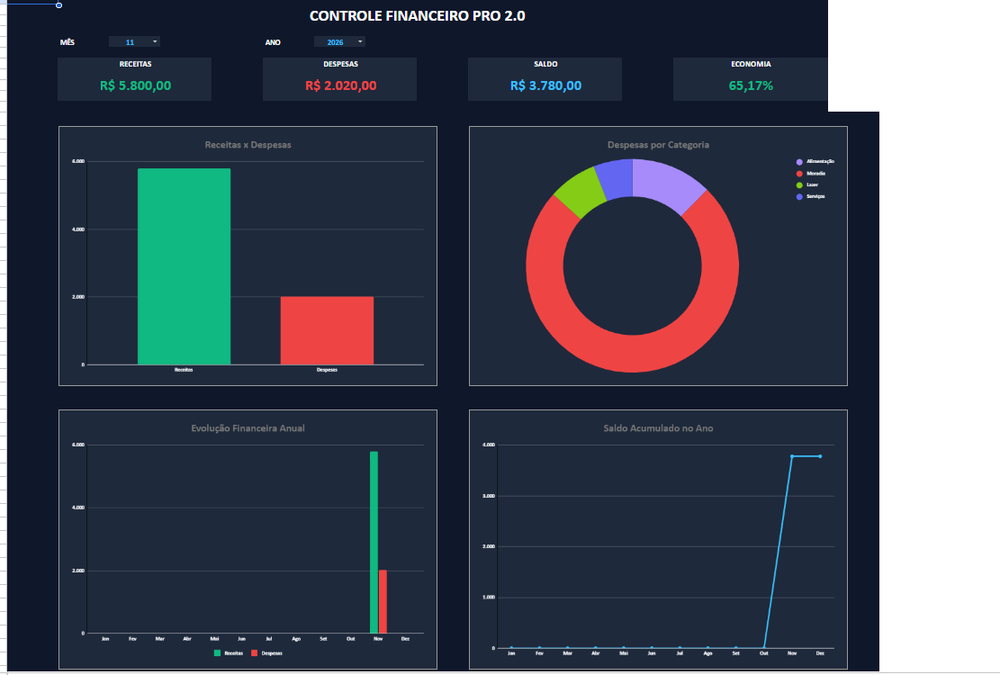

# 💰 Controle Financeiro Pro 2.0

## 📌 Project Overview

Controle Financeiro Pro 2.0 is a personal finance analytics solution designed to transform financial transactions into actionable insights through data processing, automation, and interactive dashboards.

The project combines Python, financial analytics, Business Intelligence, and software engineering principles to develop a scalable financial management solution.

## 📊 Dashboard Features

- Total income
- Total expenses
- Monthly balance
- Savings rate
- Income vs. expenses chart
- Expenses by category
- Annual financial performance
- Cumulative annual balance
- Dynamic month and year filters
- Automatic financial calculations
- Editable transaction table with data validation

## 🖼️ Dashboard Preview

*Enhanced visual concept of the Excel dashboard.*

## 🛠️ Technologies

| Technology | Purpose |
|---|---|
| Python | Automation and business logic |
| Pandas | Data processing and validation |
| OpenPyXL | Excel automation and visualization |
| Google Colab | Development environment |
| GitHub API | Automated file publishing |
| Microsoft Excel | Interactive financial dashboard |
| Git & GitHub | Version control |

## 🏗️ Data Pipeline

Financial Transactions → Data Validation → Data Processing → Financial KPIs → Excel Dashboard → GitHub Publishing

## 📂 Project Structure

- notebooks/ — Development notebooks
- data/ — Sample financial datasets
- output/ — Generated Excel workbooks
- src/ — Future application modules
- assets/ — Visual resources
- docs/ — Project documentation
- tests/ — Future automated tests

## 📈 Sample Financial Results

| Financial Indicator | Result |
|---|---:|
| Total Income | BRL 5,800.00 |
| Total Expenses | BRL 2,020.00 |
| Monthly Balance | BRL 3,780.00 |
| Savings Rate | 65.17% |

All financial data used in this project is fictional and intended for demonstration purposes.

## 📥 Download and Usage

[Download the Excel Dashboard — v0.1.0](https://github.com/thalesfreirefarias/Controle-Financeiro-Pro-/raw/main/output/Controle_Financeiro_Pro_V1.xlsx)

1. Download the Excel workbook.
2. Open the file in Microsoft Excel.
3. Access the Lançamentos worksheet.
4. Add or edit financial transactions.
5. Select the desired month and year on the Dashboard.

Financial indicators and charts are automatically recalculated by Excel.

## 🚀 Development Roadmap

- [x] Excel workbook architecture
- [x] Financial dataset creation
- [x] Data cleaning and validation
- [x] Financial KPI calculations
- [x] Interactive Excel dashboard
- [x] Dynamic financial charts
- [x] GitHub API integration
- [ ] Budget management
- [ ] Financial goals tracking
- [ ] Streamlit web application
- [ ] PostgreSQL database integration
- [ ] Supabase authentication
- [ ] Cloud deployment
- [ ] Automated testing

## 🔐 Security

GitHub authentication is managed through Google Colab Secrets. Access tokens are not hardcoded into the source code.

## 🎯 Project Objectives

This project demonstrates practical skills in:

- Data Analytics
- Business Intelligence
- Financial Analytics
- Data Quality
- Process Automation
- Data Visualization
- API Integration
- Software Engineering

## 👨‍💻 Author

**Thales Freire Farias**

Data Analytics | Financial Services | Business Intelligence

MBA in Software Engineering — USP/ESALQ

[GitHub Profile](https://github.com/thalesfreirefarias)

---

Developed as a continuous learning and professional portfolio project.
